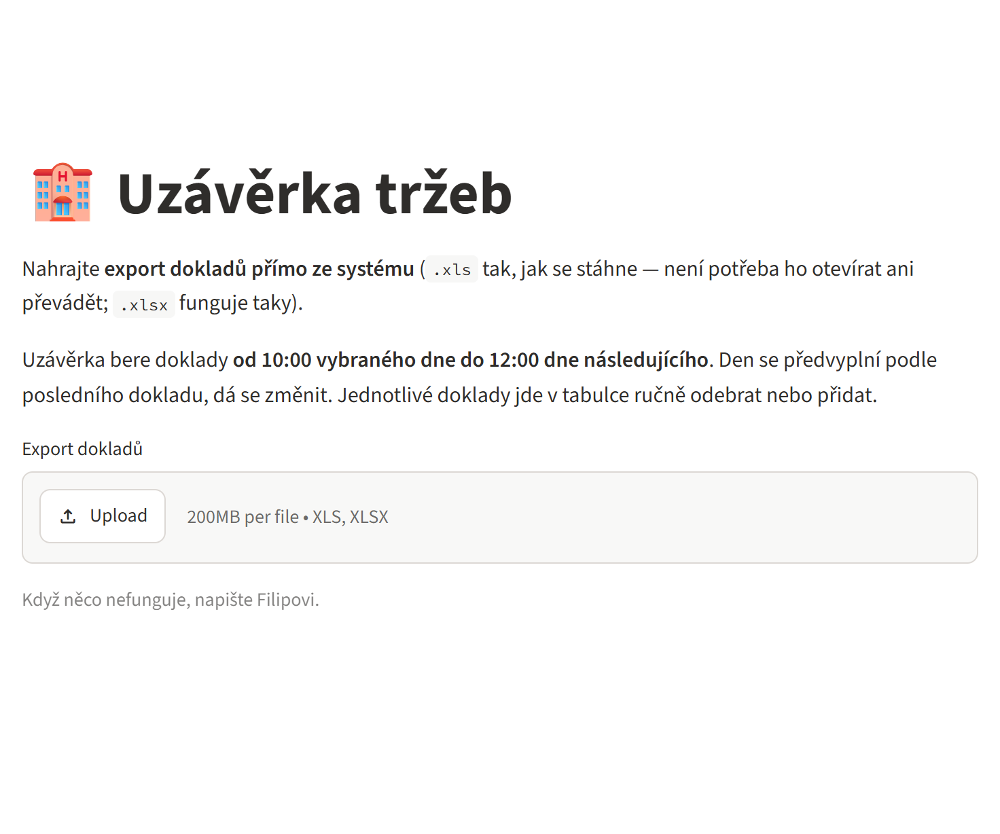
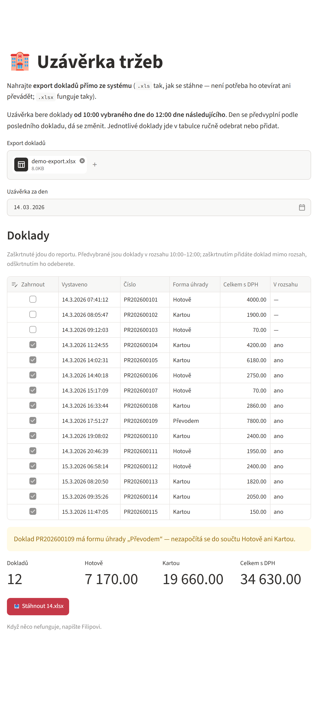
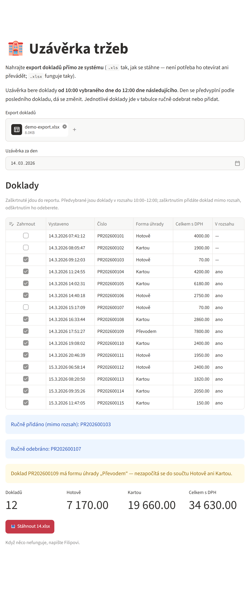
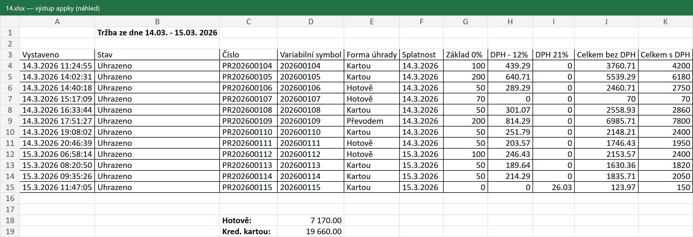

# 01 — Hotel reporter

**Stav:** hotovo · **Vzniklo:** 2026-04-17 · **Převzato sem:** 2026-11-07

**Appka:** https://hzh-hotel-reporter.streamlit.app/
· Python · Streamlit · xlrd / openpyxl / XlsxWriter

Webová appka na **denní uzávěrku tržeb hotelu**. Recepce nahraje export
dokladů tak, jak ho stáhne z hotelového systému, a appka z něj vyrobí hotový
Excel report k odevzdání — doklady za uzávěrkový den, součty hotově a kartou.

## Proč vznikla

Uzávěrka se dřív dělala ručně a s několika zbytečnými kroky:

1. Stáhnout export dokladů — starý formát `.xls`, otevře se jen v chráněném zobrazení.
2. Otevřít ho v Excelu, povolit úpravy a uložit jako `.xlsx`.
3. Ručně vybrat doklady od 10:00 do 12:00 dalšího dne, přepsat čísla dokladů,
   sečíst platby hotově a kartou.

Teď stačí export nahrát a stáhnout hotový report.

## Ukázka

> Screenshoty jsou nad **smyšlenými daty** ([`ukazka/demo-export.xlsx`](ukazka/demo-export.xlsx)),
> skutečné exporty obsahují údaje hostů a do repa nepatří.

**1. Nahrání exportu** — `.xls` přímo ze systému, bez převádění.



**2. Přehled** — den uzávěrky se předvyplní sám, předvybrané jsou doklady
v rozsahu 10:00–12:00. Appka upozorní na doklad, který by se do součtů
nezapočítal (tady platba převodem).



**3. Ruční úprava výběru** — doklad jde odebrat nebo přidat i mimo rozsah,
součty i report se hned přepočítají a appka vypíše, co se ručně změnilo.



**4. Výstup** — Excel ve formátu k odevzdání, pojmenovaný číslem dne
(`14.xlsx`). Obrázek je náhled vykreslený ze souboru
[`ukazka/ukazkovy-vystup-14.xlsx`](ukazka/ukazkovy-vystup-14.xlsx).



## Co umí

- Čte **přímo `.xls` z hotelového systému** (i `.xlsx`). Export má drobně
  poškozenou vnitřní strukturu — Excel ji toleruje, `xlrd` jen
  s `ignore_workbook_corruption=True`.
- Hledá sloupce podle **přesných názvů**; když některý chybí, řekne který.
- **Den uzávěrky** D = doklady od D 10:00 do D+1 12:00. Navrhne se z posledního
  dokladu (po 12:00 → jeho den, jinak den předtím), jde změnit.
- **Ruční výběr dokladů** zaškrtávátky.
- **Kontroly:** číslo dokladu vs. variabilní symbol, neznámá forma úhrady,
  jiný stav než „Uhrazeno“.
- Výstup: ohraničená tabulka, číslo dokladu jako text `PR<VS>`, součty jako
  vzorce i s předpočítanou hodnotou (zobrazí se i v chráněném zobrazení Excelu).

## Struktura

```
kod/
  app.py              rozhraní (Streamlit)
  zpracovani.py       logika — načtení, výběr dokladů, tvorba Excelu
  requirements.txt
ukazka/
  vytvor_demo_export.py   vyrobí smyšlený export pro ukázku
  demo-export.xlsx        smyšlený export
  ukazkovy-vystup-14.xlsx výstup appky z něj
  screenshoty/
```

## Spuštění lokálně

```
cd kod
pip install -r requirements.txt
streamlit run app.py
```

Na vyzkoušení nahrajte `ukazka/demo-export.xlsx`.

## Aktuální stav (2026-11-07)

- Hotovo: přepracováno a nasazeno na Streamlit Cloud z tohohle repa
  (main file `projekty/01-hotel-reporter/kod/app.py`); stará appka
  z archivovaného repa smazaná. Přidaná ukázka se screenshoty.
- Ověřeno: skutečný export z 6.–7. 11. dává výstup shodný s ručně
  připraveným reportem (0 rozdílů v buňkách); hraniční případ „jen tržby
  6. večer“ → `6.xlsx`; ruční přidání/odebrání dokladu v prohlížeči.
- Zbývá: nic.
- Blokuje: nic

## Poznámky k vývoji

- **Každý push do `main` se rovnou nasadí** (Streamlit Cloud). Větší změny
  nejdřív vyzkoušet lokálně.
- Skutečné exporty → **nikdy do repa** (je veřejné). Leží lokálně
  v `C:\Users\Fikus\Filip-projekty-data\01-hotel-reporter\`
  (`vstupy/` originály, `vystupy/` vygenerované reporty).
- Původní repo `lnenickafi/hotel-reporter` je od 2026-11-07 soukromé
  a archivované (převzat stav z commitu `993ffec`, historie zůstala tam).
